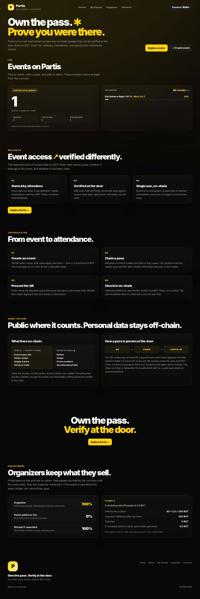
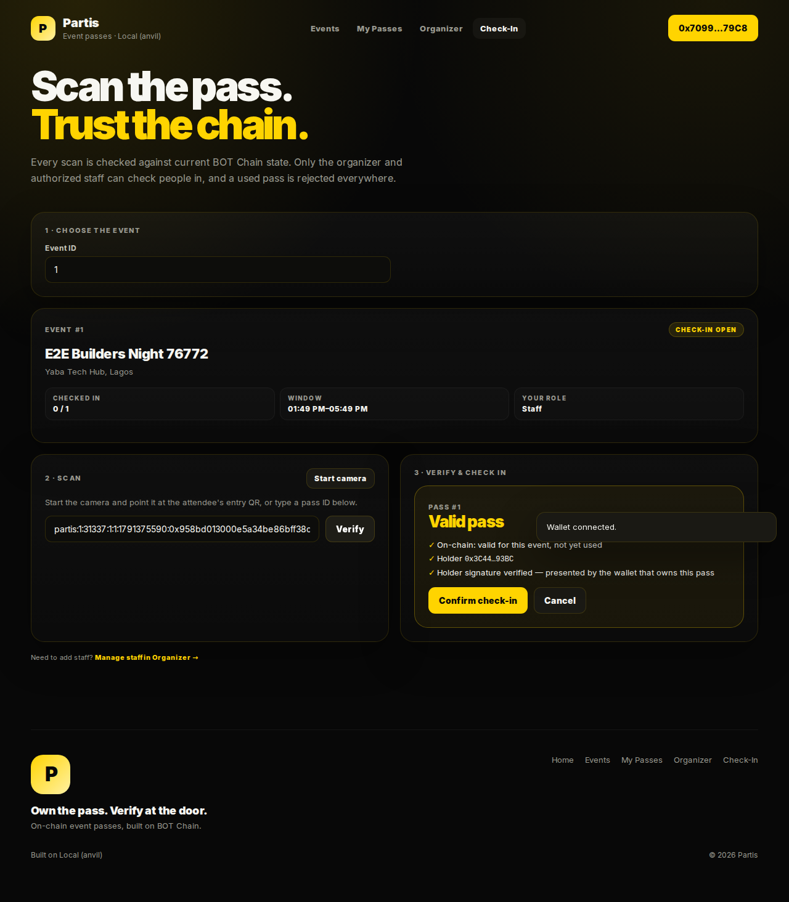
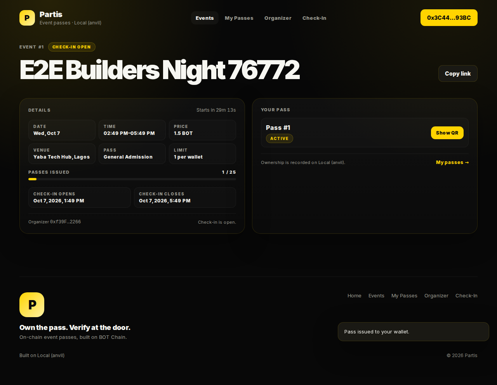
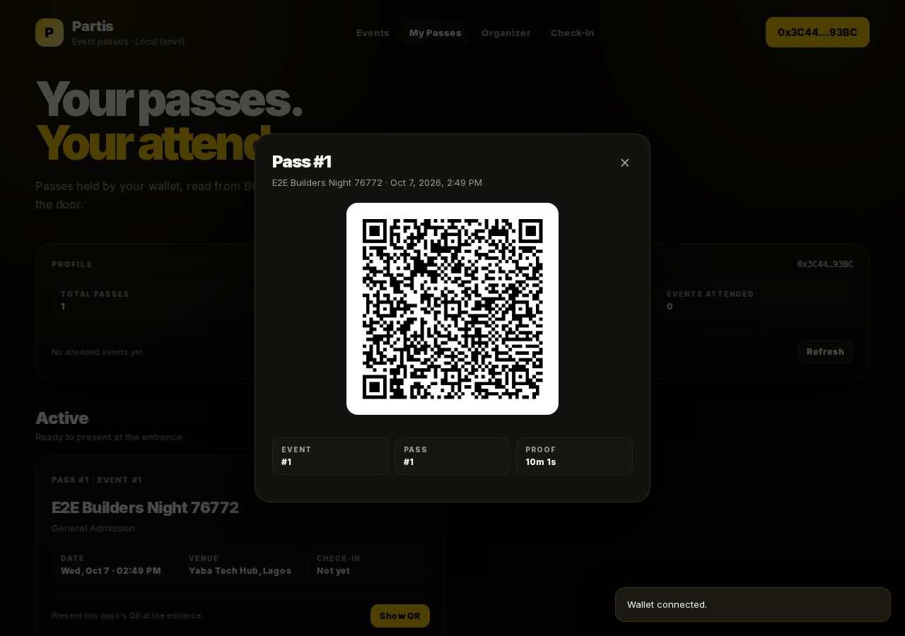
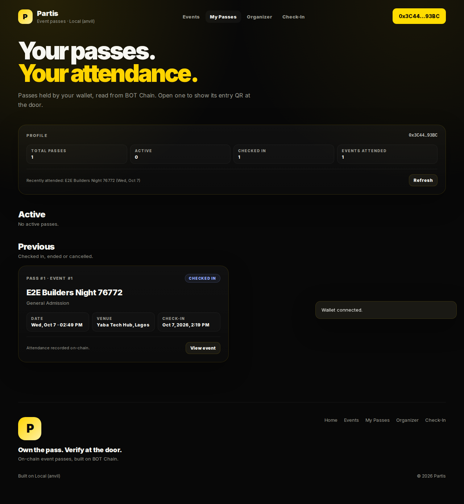

# Partis

**Partis turns real-world event access into on-chain passes that can be verified at the door.**

Organizers create events on BOT Chain. Attendees claim free passes or buy fixed-price ones
straight into their wallet. At the venue, staff scan the attendee's QR, Partis checks the pass
against live chain state, and the check-in itself is recorded on-chain. A used pass is rejected
everywhere.

```text
Event → On-chain pass → Wallet ownership → QR at the door → BOT Chain verification → On-chain attendance
```

| Home | Check-in at the door |
|---|---|
|  |  |

| Event page | Entry QR | My passes |
|---|---|---|
|  |  |  |

<sub>Screenshots are from the automated browser test run against a local chain, so the network
label reads "Local (anvil)".</sub>

---

## Why BOT Chain is load-bearing

Partis has no backend and no database. The contract is the source of truth for everything that
decides access:

| What | Where it's enforced |
|---|---|
| Event IDs, configuration, supply, price | `PartisEventPass` storage, validated at creation |
| Pass issuance and ownership | ERC-721 mint, enforced supply, exact-price payment, sales window, optional one-per-wallet |
| Check-in state | `checkIn` marks the pass used; replays revert |
| Who may check people in | organizer or per-event staff, checked by the contract |
| Payments | escrowed per event, withdrawable after the event, fully refundable on cancellation |
| Discovery and stats | read from paginated contract views, not an index |

The QR code is just a pointer (`chain:event:pass` plus an optional holder signature). It is
never trusted on its own; every scan re-reads the contract.

There is no project token and no platform fee. The pass is the only token.

## How it works

1. **Create.** An organizer describes the event in one sentence (name, venue, date, times, supply,
   free or fixed price in BOT, one-per-wallet, check-in lead time) and signs `createEvent`. The
   event gets an on-chain ID and a public page at `/events/<id>`.
2. **Claim or buy.** An attendee opens the page, connects a wallet and calls `claim` (sending the
   exact price for paid events). The contract enforces supply, price, sales window, pause state
   and the wallet limit, then mints the pass.
3. **Present.** On `/passes` the attendee opens the pass and signs a free, 10-minute entry
   message with their wallet. The QR encodes the pass and that signature.
4. **Verify.** Staff open `/check-in`, choose the event they're admitting to, and scan. The app
   calls `verifyPass(event, pass)` and checks the signature against the pass's current owner.
   Fake, wrong-event, already-used, cancelled and out-of-window passes fail with a clear reason.
5. **Check in.** An authorized operator confirms. `checkIn` records it on-chain, the pass can no
   longer be transferred, and any further scan shows "Already checked in".

## Repository layout

```
contracts/                 Foundry project
  src/PartisEventPass.sol     events, passes (ERC-721), staff, check-in, payments
  src/PartisPassRenderer.sol  on-chain JSON + SVG pass metadata (split out for code size)
  test/                       59 tests: unit, fuzz, reentrancy, stateful invariants
  script/Deploy.s.sol         chain-guarded deploy, writes deployments/<chainId>.json
web/                       Next.js 16 + wagmi 3 + viem
  src/app/                    the 6 routes: / · /events · /events/[eventId] · /passes · /organizer · /check-in
  src/lib/                    chain config, entry-QR protocol, door verification, status logic (unit-tested)
  e2e/                        Playwright tests of the full flow through the UI
scripts/
  e2e-local.sh                full loop with real transactions on anvil, via cast
  e2e-browser.sh              fresh chain + deploy + production build + Playwright
  metrics.sh                  usage metrics read from chain state
  export-abi.mjs              contract ABI → web/src/lib/abi.ts
docs/
  PRD.md · frontend.md        product and design source of truth
  BOT_CHAIN_CONFIG.md         verified network values and their sources
  THREAT_MODEL.md             PRD §23 threats, roles, residual risks
  DEPLOYMENT.md               testnet → mainnet plan
  BUILD_LOG.md                what was built, decisions, open items
```

## Quick start

Requirements: [Foundry](https://getfoundry.sh), Node 22+, `jq`.

```bash
git clone --recurse-submodules <repo-url> partis && cd partis

# Contracts
cd contracts && forge test && cd ..

# Web (unit tests)
cd web && npm ci && npm test && cd ..

# Run everything locally
anvil                                        # terminal 1
./scripts/e2e-local.sh                       # terminal 2: deploy + exercise the loop on-chain
cd web && cp .env.example .env.local         # set NEXT_PUBLIC_CHAIN_ID=31337 and the address
                                             # from contracts/deployments/31337.json
npm run dev                                  # http://localhost:3000
```

Browser end-to-end test (organizer creates → attendee buys → signed QR → staff checks in →
replay and fake pass rejected → stranger refused):

```bash
./scripts/e2e-browser.sh
```

## Networks

Verified from the official BOT Chain developer docs on 2026-10-07; see
[docs/BOT_CHAIN_CONFIG.md](docs/BOT_CHAIN_CONFIG.md) for sources. Re-verify before deploying.

| | Chain ID | RPC | Explorer |
|---|---|---|---|
| BOT Chain Testnet | 968 | https://rpc.bohr.life | https://scan.bohr.life |
| BOT Chain Mainnet | 677 | https://rpc.botchain.ai | https://scan.botchain.ai |

The web app runs against one chain per build (`NEXT_PUBLIC_CHAIN_ID`, `NEXT_PUBLIC_PARTIS_ADDRESS`).

## Deployments

| Network | PartisEventPass | PartisPassRenderer |
|---|---|---|
| BOT Chain Testnet (968) | [`0x07aF133344a4da79872117e612febCf4851798F5`](https://scan.bohr.life/address/0x07aF133344a4da79872117e612febCf4851798F5) ✓ verified | [`0x0405b784346330f690c85A559ba4C2B05e610650`](https://scan.bohr.life/address/0x0405b784346330f690c85A559ba4C2B05e610650) ✓ verified |
| BOT Chain Mainnet | *not deployed yet* | *not deployed yet* |

Deploying needs a funded deployer wallet: fill in `contracts/.env` (from `.env.example`) and run
`./scripts/deploy-testnet.sh`, or follow [docs/DEPLOYMENT.md](docs/DEPLOYMENT.md). The
addresses land in `contracts/deployments/<chainId>.json`, which should be committed and linked here.

## Testing

| Layer | What | Command |
|---|---|---|
| Contracts | 59 tests: lifecycle, issuance, check-in threats, transfers, payments/reentrancy, metadata escaping, views, plus 4 stateful invariants (no duplicate check-ins, supply bounds, solvency, cancelled ⇒ no check-ins) | `cd contracts && forge test` |
| Web logic | 21 tests: entry-QR protocol, door verification for every §23 threat, status mapping, form validation | `cd web && npm test` |
| On-chain loop | every PRD §5 step and failure path, as real transactions | `./scripts/e2e-local.sh` |
| UI end-to-end | the full flow through the browser with Playwright | `./scripts/e2e-browser.sh` |

CI (`.github/workflows/ci.yml`) runs formatting, contract tests, lint, type-check, unit tests and
a production build on every push.

## Security

- No admin, no owner, no upgrades, no pause switch. Every privilege is scoped to one event.
- Checks-effects-interactions and `nonReentrant` on every function that moves value.
- Bounded loops only; every list is paginated (≤100) and staff are capped at 50 per event.
- No personal data on-chain or in QR codes. The app has no backend.

Full analysis: [docs/THREAT_MODEL.md](docs/THREAT_MODEL.md). The contracts have not had an
external audit.

## Metrics

All usage numbers come from chain state; nothing is estimated or seeded.

```bash
./scripts/metrics.sh https://rpc.bohr.life <PartisEventPass address>
```

This reports events, organizers (and repeat organizers), unique attendees, passes issued,
average passes per event, check-ins and check-in rate, and paid volume. The home page shows the
same live counters.

## Assumptions and known limitations

- **One chain per build.** The app targets the chain in `NEXT_PUBLIC_CHAIN_ID`. Multi-chain is a
  PRD non-goal.
- **Native BOT only** for paid passes. ERC-20 payment is out of MVP scope; the event model
  already records `paymentAsset` (`address(0)` = BOT).
- **Discovery reads the contract directly.** Events are fetched in pages of 100. That's fine at
  MVP scale; beyond a few thousand events an indexer should serve lists, with the contract still
  authoritative for verification.
- **Unsigned entry.** A pass ID typed by hand, or an ID-only QR, doesn't prove who is presenting
  it. Staff must explicitly confirm before admitting. Signed QRs remove this gap.
- **Sybil resistance.** One-pass-per-wallet doesn't stop one person using many wallets.
- **Proceeds are locked until the event ends** so cancellation refunds are always possible.
- **Organizer trust.** Organizers can edit an event's description and venue after sales; times,
  supply and price are immutable.
- **Wallets.** Any injected EIP-1193 wallet (MetaMask, BO Wallet). WalletConnect is not wired up.
- **Time display** uses the viewer's local time zone; the chain uses block time.

## Status against the PRD Definition of Done

| Item | Status |
|---|---|
| Contracts written, tested, verified-ready | ✅ done (59 tests, invariants, threat model) |
| Contracts deployed + verified on BOT Chain | ✅ testnet, deployed and verified on BOTScan 2026-10-08 (block 26131805); mainnet ⏳ after the validation gate |
| Frontend: 6 routes, wallet, create, claim/buy, QR, scan, check-in, organizer, discovery, error states | ✅ done, tested end-to-end in a browser |
| Ownership verifiable, used pass rejected, unauthorized check-in prevented, wrong event rejected | ✅ enforced on-chain and covered by tests |
| README, threat model | ✅ |
| Frontend deployed | ⏳ runs against testnet locally; public hosting not set up yet |
| Testnet testing with real users, real event, demo video, mainnet | ⏳ not done yet — these need real people and funds |

## License

MIT
